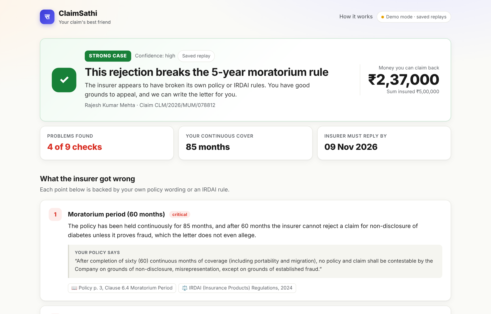
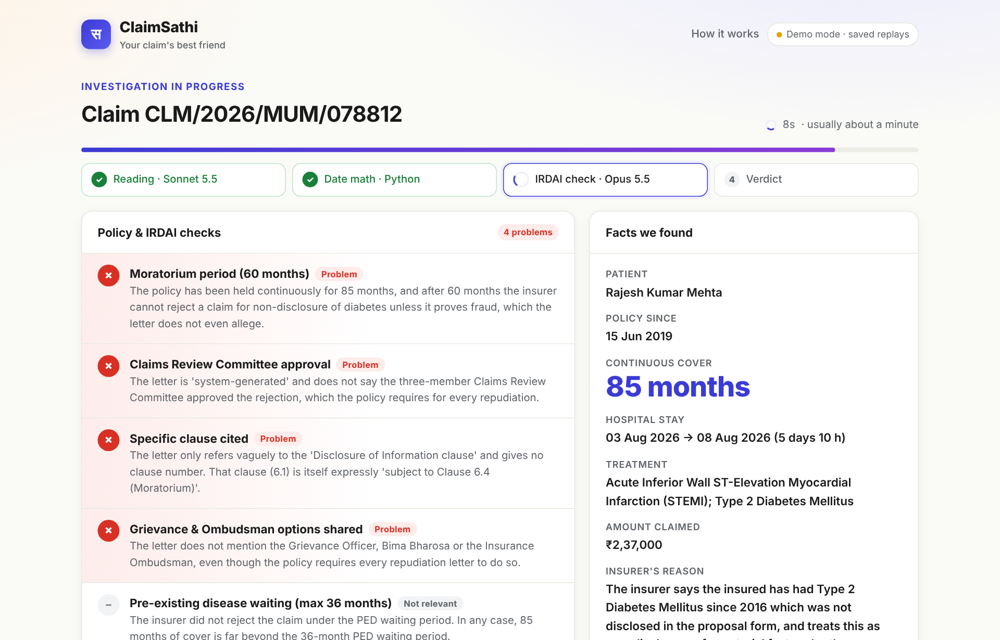
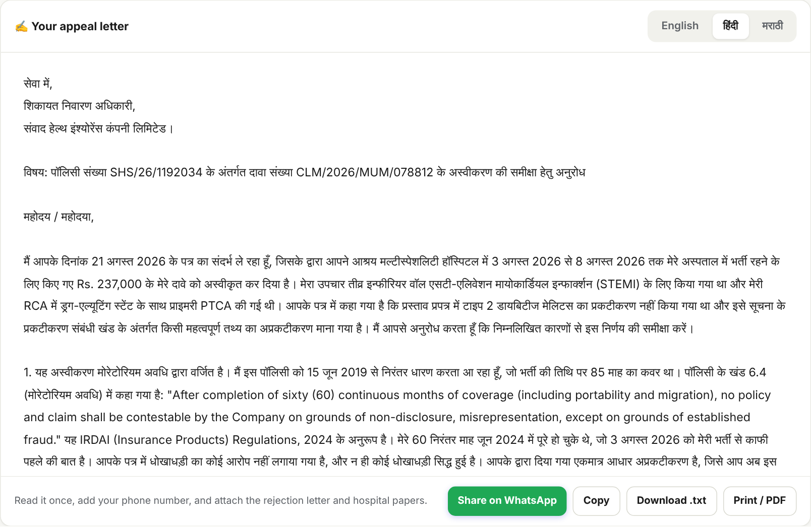
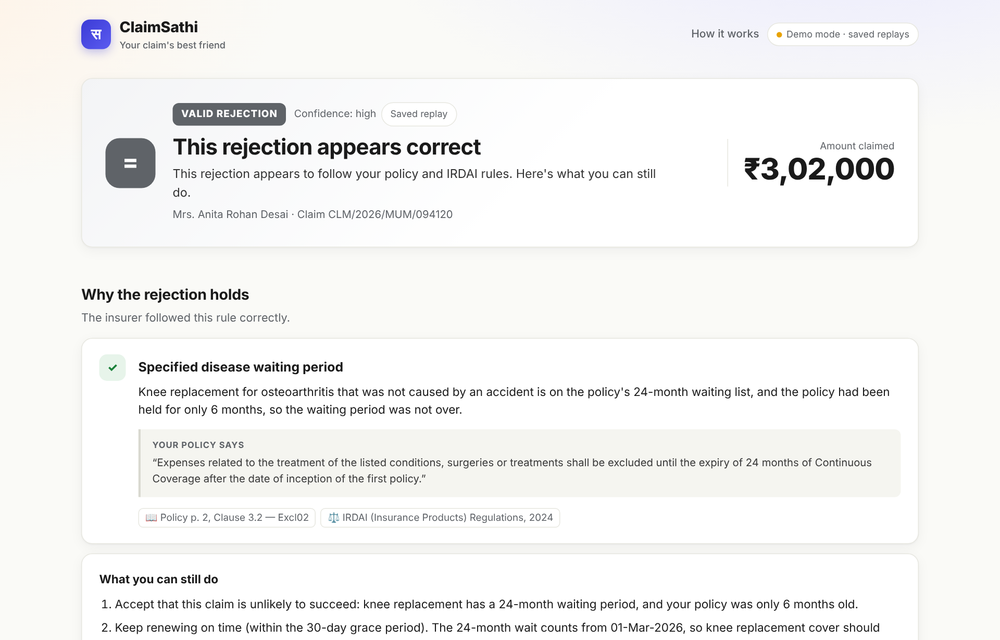
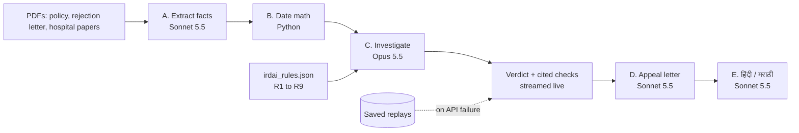

# ClaimSathi · क्लेम साथी

**Your health insurance claim was rejected. ClaimSathi tells you in about 30 seconds whether that was fair, and writes the letter to get your money back.**

> **Opus 5.5 investigates · Sonnet 5.5 fights for you**
> Built at the Claude Opus 5.5 × Sonnet 5.5 Build Day, Mumbai · Track: **Everyday**



## The problem

- **1 in 12** health insurance claims in India is rejected (8% of 3.26 crore claims in FY25, about 26 lakh people).
- **36%** of policyholders say their claim was fully rejected for invalid reasons (LocalCircles survey of 30,366 policyholders).
- Health is **61%** of all insurance complaints but only about 11% of premiums. Ombudsman complaints have doubled in six years.
- Most families never appeal. Checking a rejection means reading a 40-page policy against the rejection letter and knowing IRDAI rules such as the 5-year moratorium or the 36-month cap on waiting periods.

Insurers have claims teams. Patients have nobody. ClaimSathi is that somebody.

## What it does

1. **Upload 3 documents:** policy (wording + schedule), the rejection letter, hospital papers (discharge summary + bill). Or tap a sample case.
2. **Investigates live:** Sonnet 5.5 reads the PDFs, Python does the date math exactly, and Opus 5.5 checks the rejection against the policy and **9 IRDAI rules**. Every finding quotes the exact clause and page.
3. **Gives an honest verdict:** STRONG CASE · CONTESTABLE · VALID REJECTION. If the insurer is right, ClaimSathi says so.
4. **Fights back:** a ready-to-send appeal letter in **English, हिंदी or मराठी**, a WhatsApp share button, and the escalation timeline (Grievance Officer → Bima Bharosa → Insurance Ombudsman).

| Live investigation | Appeal letter in Hindi | Honest when the insurer is right |
| --- | --- | --- |
|  |  |  |

## Results on the test set: 4 / 4

Live run of `python scripts/eval_cases.py` against the expert answer key:

| Case | Claim | Insurer's mistake | Expected | ClaimSathi | Time |
| --- | --- | --- | --- | --- | --- |
| 01 | Heart attack, ₹2,37,000 | "Non-disclosure" after 85 months of cover (moratorium rule) | STRONG CASE | ✅ STRONG CASE | 32 s |
| 02 | Cataract, ₹48,500 | "Less than 24 hours" for a listed Day Care procedure | STRONG CASE | ✅ STRONG CASE | 30 s |
| 03 | BP emergency, ₹1,31,000 | 48-month PED wait applied; policy says 36 | STRONG CASE | ✅ STRONG CASE | 37 s |
| 04 | Knee replacement, ₹3,02,000 | None: 24-month wait genuinely not complete | VALID REJECTION | ✅ VALID REJECTION | 28 s |

Claude also flagged two rejection letters that never mention Claims Review Committee approval, a procedural gap the hand-written answer key had missed.

## How it works



- **Numbers never come from the model.** Months of continuous cover, stay length and deadlines are computed in Python.
- **Every model output is validated** with Pydantic and retried once if malformed.
- **Live streaming** (Server-Sent Events) shows each check as it lands.
- **Fail-safe:** any API error or timeout switches to a saved replay with a visible notice, so a demo never breaks.

### The 9 IRDAI rules checked

| ID | Rule |
| --- | --- |
| R1 | Moratorium: after 60 months of continuous cover, no rejection for non-disclosure except proven fraud |
| R2 | Pre-existing disease waiting period capped at 36 months |
| R3 | Specified disease waiting period (as per policy, max 36 months; not for accidents) |
| R4 | 24-hour hospitalisation rule does not apply to listed Day Care procedures |
| R5 | Every rejection needs Claims Review Committee approval |
| R6 | Rejection must cite the specific policy clause |
| R7 | Insurer must share grievance and Ombudsman options |
| R8 | Insurer collects documents from the hospital |
| R9 | Payable = min(bill, sub-limit, sum insured) |

Sources: IRDAI (Insurance Products) Regulations 2024; IRDAI Master Circular on Health Insurance 2024; Insurance Ombudsman Rules 2017.

## Run it

```bash
cd backend
python3 -m venv ../.venv && source ../.venv/bin/activate
python -m pip install -r requirements.txt
cp .env.example .env      # add ANTHROPIC_API_KEY (and ANTHROPIC_WORKSPACE_ID for org-scoped keys)
python -m uvicorn main:app --reload --port 8000
```

Open **http://localhost:8000**. FastAPI serves both the API and the frontend.

| Mode | How |
| --- | --- |
| Live | API key in `backend/.env` |
| Demo replay (no internet) | `http://localhost:8000/?demo=1` or `FORCE_DEMO=1` |
| Test against the answer key | `python scripts/eval_cases.py` (add `--save` to refresh the replays) |

Health check: `/api/health` · API docs: `/docs`

## Repository layout

| Path | What |
| --- | --- |
| `backend/main.py` | FastAPI routes: cases, SSE investigation, result, letter, health |
| `backend/pipeline.py` | AI stages, case store, live and replay streams |
| `backend/prompts.py` | System prompts for each stage |
| `backend/schemas.py` | Pydantic models |
| `backend/dates.py` | Date math (months of cover, stay, deadlines) |
| `backend/data/irdai_rules.json` | Rules R1 to R9 |
| `backend/data/samples/` and `demo-pdfs/` | 4 fictional sample cases as PDFs |
| `backend/data/demo/` | Saved real Claude outputs (replays) |
| `frontend/` | Web app (HTML, CSS, JS) |
| `docs/` | SRS, answer key, screenshots |

## Roadmap

- **Partial deductions:** check every bill line the insurer cut ("non-payable items", room-rent caps). Bigger market than full rejections.
- **Before treatment:** "Will my surgery be covered?" checks against your own policy.
- **At the hospital:** cashless denials and the 1-hour / 3-hour IRDAI deadlines.
- **More languages**, Ombudsman complaint filing, and a B2B version for HR teams and brokers.

## Stack

Python · FastAPI · Anthropic Python SDK (`claude-opus-5-5`, `claude-sonnet-5-5`) · Pydantic · sse-starlette · HTML/CSS/JS

## Disclaimer

ClaimSathi helps you understand your rejection and draft an appeal. It is not legal advice. All sample people, insurers, hospitals and numbers are fictional.
